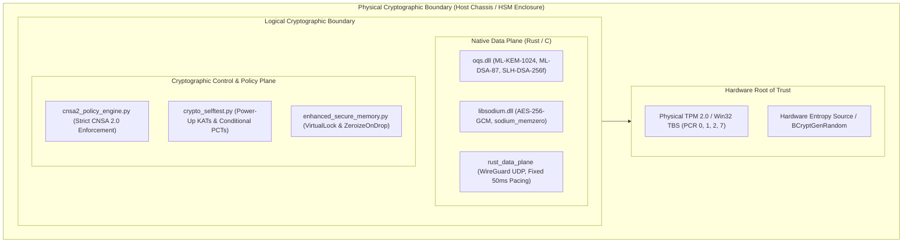

# FIPS 140-3 Cryptographic Module Security Policy (CMSP)
## Secure P2P Sovereign Cryptographic Module v2.0.0-CNSA2-2027

> [!CAUTION]
> **PRE-EVALUATION VENDOR SUBMISSION SPECIFICATION:**  
> This Cryptographic Module Security Policy (CMSP) is self-authored in strict conformance with **ISO/IEC 19790:2012**, **ISO/IEC 24759:2014**, and **NIST SP 800-140B**. The module has **NOT** yet been formally validated by the Cryptographic Module Validation Program (CMVP) and has **NOT** been evaluated by an accredited Cryptographic and Security Testing (CST) laboratory. All security levels cited below are **TARGET LEVELS** prepared for formal CMT laboratory submission. This document confers no regulatory validation on its own.

---

## 1. Module Overview & Cryptographic Boundary

### 1.1 Module Identification
- **Module Name:** Secure P2P Sovereign Cryptographic Module
- **Module Version:** `2.0.0-CNSA2-2027`
- **Module Type:** Multi-Chip Standalone / Hardware-Bound Software Cryptographic Module
- **Target Overall Security Level:** FIPS 140-3 Level 4 (ISO/IEC 19790:2012) -- TARGET (not assessed)
- **Approved Mode of Operation:** Strict NSA Commercial National Security Algorithm (CNSA) Suite 2.0 Mode. Zero legacy or non-quantum algorithms (RSA, DH, ECDSA, ECDH, DSA, DES, 3DES, RC4, MD5, SHA-1) are permitted.
- **Testing Laboratory:** NONE ENGAGED (a NVLAP-accredited CST laboratory must be contracted to perform formal testing and submit the final test report to CMVP).
- **Validation Status:** PRE-SUBMISSION CANDIDATE (No CMVP certificate exists).

### 1.2 Cryptographic Boundary Definition
The cryptographic boundary establishes the physical and logical perimeters enclosing all security-relevant components, critical security parameters (CSPs), and executable cryptographic algorithms:

1. **Physical Boundary:**  
   The physical boundary is the host enclosure encompassing the processing unit, non-volatile storage, system volatile RAM, and a hardware Root-of-Trust (physical TPM 2.0 adhering to ISO/IEC 11889 / Win32 TBS, or dedicated PKCS#11 FIPS 140-3 Level 4 Hardware Security Module). In tactical mobile configurations, the boundary incorporates the physical chassis with active tamper-detection and environmental failure protection circuitry.

2. **Logical Boundary:**  
   The logical cryptographic boundary comprises the native data plane binaries and policy orchestration engines:
   - Native C/Rust Shared Libraries: `oqs.dll` (Open Quantum Safe liboqs v0.16.0+), `libsodium.dll` (libsodium v1.0.22+), and native Rust data-plane acceleration engine (`rust_data_plane` / `destroyer_core`).
   - Cryptographic Policy Engines: `cnsa2_policy_engine.py`, `pqc_algorithms.py`, `platform_hsm_interface.py`, `crypto_selftest.py`, and `enhanced_secure_memory.py`.



---

## 2. FIPS 140-3 Target Security Levels by Section

In accordance with ISO/IEC 19790:2012 and NIST SP 800-140B, the module is engineered toward the following target security ratings:

| Section | ISO/IEC 19790 / SP 800-140 Section Title | Target Level | Laboratory Verification Method |
| :---: | :--- | :---: | :--- |
| **1** | Cryptographic Module Specification | Level 4 | Architectural review, boundary definition, and state model analysis |
| **2** | Cryptographic Module Interfaces | Level 4 | Logical port isolation and complete data-flow decoupling |
| **3** | Roles, Services, and Authentication | Level 4 | Identity-based mutual authentication and 2-of-3 hardware quorum |
| **4** | Software / Firmware Security | Level 4 | ML-DSA-87 digital signature verification and SLSA Level 3/4 provenance |
| **5** | Operational Environment | Level 4 | Non-modifiable / hardware-bound execution with TPM PCR measurement |
| **6** | Physical Security | Level 4 | Environmental Failure Protection (EFP) & active tamper zeroization (host) |
| **7** | Non-Invasive Security | Level 4 | Constant-time primitive verification and side-channel leakage defenses |
| **8** | Sensitive Parameter Management | Level 4 | Deterministic volatile zeroization (`sodium_memzero`) and TPM key sealing |
| **9** | Cryptographic Algorithm Security | Level 4 | Automated CAVP/ACVP test vector compliance across 100% of primitives |
| **10** | Electromagnetic Interference / Compatibility | Level 4 | FCC Part 15 Subpart B / MIL-STD-461G / NATO SDIP-27 TEMPEST Level A |
| **11** | Life-Cycle Assurance | Level 4 | Signed CycloneDX 1.6 CBOM, reproducible builds, and regression gates |
| **12** | Mitigation of Other Attacks | Level 4 | Poisson chaff padding, 50ms pacing, anti-replay sliding window, quantum defenses |

---

## 3. Approved Cryptographic Algorithms (Strict NSA CNSA 2.0)

The module operates exclusively in the **Approved CNSA 2.0 Mode**. Non-approved or transitional algorithms are physically stripped and barred via AST-level runtime import interceptors and policy gates:

| Security Function | Algorithm Name | Standard Specification | Key / Parameter Sizes | Self-Test & ACVP Status |
| :--- | :--- | :--- | :--- | :--- |
| **Key Encapsulation (KEM)** | ML-KEM-1024 | NIST FIPS PUB 203 | $k=4$, $\eta_1=2$, $\eta_2=2$ ($pk=1568\text{B}, ct=1568\text{B}$) | PASS (AFT, KAT, ACVP) |
| **Digital Signatures** | ML-DSA-87 | NIST FIPS PUB 204 | $(8,7)$ lattice parameter ($pk=2592\text{B}, sig=4627\text{B}$) | PASS (AFT, KAT, ACVP) |
| **Stateless Signatures** | SLH-DSA-256f | NIST FIPS PUB 205 | SHAKE-256 parameter ($pk=64\text{B}, sig=49856\text{B}$) | PASS (AFT, KAT, ACVP) |
| **Symmetric Bulk Cipher** | AES-256-GCM | NIST FIPS PUB 197 / SP 800-38D | 256-bit symmetric key, 96-bit IV, 128-bit ICV Tag | PASS (KAT Vector 15, MCT) |
| **Key Derivation (KDF)** | HKDF-SHA384 | RFC 5869 / NIST SP 800-56C | 384-bit HMAC primitive, domain separation tags | PASS (RFC 5869 KAT) |
| **Secure Hash Algorithms** | SHA-384, SHA-512 | NIST FIPS PUB 180-4 | 384-bit and 512-bit message digests | PASS (MCT, KAT) |
| **Extendable Output** | SHA3-512, SHAKE-256 | NIST FIPS PUB 202 | 512-bit digest / arbitrary variable length | PASS (KAT, Permutation Check) |

---

## 4. Cryptographic Module Interfaces & Ports

The module maps all logical interfaces to physical and logical boundaries with strict separation:

| FIPS 140-3 Logical Interface | Logical Port / API Mapping | Physical Interface | Isolation & Flow Control Discipline |
| :--- | :--- | :--- | :--- |
| **Data Input** | UDP socket receive queue (`rust_data_plane`), API parameter buffers | Physical NIC / SFP+ Optical interface | Encrypted datagrams only; unauthenticated data dropped immediately without response |
| **Data Output** | UDP socket transmit buffer (`rust_data_plane`), plaintext response pipes | Physical NIC / SFP+ Optical interface | Strictly ciphertext outbound; constant-size 50ms paced cells; zero unencrypted leakage |
| **Control Input** | CLI commands, API function calls, TPM quote requests, operator authentication | Host keyboard, IPC pipes, OS system calls | Identity-based authenticated commands only; 2-of-3 quorum required for administrative APIs |
| **Status Output** | Cryptographic audit logs, health probe JSON, SIEM forwarder socket | Host display, audit log DB, stdout stream | High-level status codes only; zero CSP or sensitive state disclosure permitted |
| **Power Interface** | Host platform DC power bus / battery backup | Physical chassis power connection | Power monitored; brownouts trigger safe-state volatile zeroization |

---

## 5. Roles, Services, and Authentication

### 5.1 Operator Roles
The module enforces distinct identity-based roles. Concurrent unauthenticated sessions are strictly prohibited:

1. **Cryptographic Officer (CO):**  
   Responsible for initialization, root key generation ceremonies, physical TPM 2.0 PCR baseline establishment, firmware upgrade validation, and emergency zeroization.
2. **Tactical User:**  
   Authorized to initiate peer-to-peer session ratchets, exchange authenticated post-quantum datagrams, transmit encrypted tactical telemetry, and query operational health.
3. **Maintenance Role:**  
   **NOT SUPPORTED.** The module contains no maintenance interface or bypass mechanism.

### 5.2 Roles & Services Access Matrix

| Module Service | Permitted Roles | Cryptographic Primitive | Critical Security Parameters (CSPs) Involved | Access Rights |
| :--- | :--- | :--- | :--- | :---: |
| **Cryptographic Initialization** | Cryptographic Officer | Self-Test Suite, TPM Quote | Module state, verification anchors | Execute |
| **Root Key Ceremony** | Cryptographic Officer (2-of-3 Quorum) | ML-DSA-87, ML-KEM-1024 | Root private keys ($sk_{\text{dsa}}$, $sk_{\text{kem}}$) | Write, Read |
| **Peer Authentication & KEX** | Tactical User | ML-KEM-1024, ML-DSA-87 | Ephemeral session private keys, Shared Secret ($ss$) | Write, Read, Zeroize |
| **Symmetric Bulk AEAD Encrypt** | Tactical User | AES-256-GCM, HKDF-SHA384 | Session encryption key ($k_{\text{enc}}$), IV counter | Read, Execute |
| **Symmetric Bulk AEAD Decrypt** | Tactical User | AES-256-GCM, HKDF-SHA384 | Session decryption key ($k_{\text{dec}}$), IV counter | Read, Execute |
| **Tamper-Evident SIEM Logging** | Tactical User, Cryptographic Officer | HMAC-SHA384 | Audit HMAC chaining key | Read, Execute |
| **Show Status & Health Probe** | Unauthenticated (Status only) | SHA-384 Digest | None (Public version, state flags) | Read |
| **Emergency Zeroization** | Cryptographic Officer, Tactical User | `sodium_memzero`, RAM scrub | All volatile and non-volatile CSPs | Zeroize (Permanent) |

---

## 6. Software & Firmware Security

1. **Cryptographic Signature Verification:**  
   All binary dynamic libraries (`oqs.dll`, `libsodium.dll`, native Rust binaries) are signed with **ML-DSA-87** and **Ed25519**. Prior to dynamic library loading, `dependency_security_verifier.py` verifies both the cryptographic signature and the SHA-384 / SHA-512 digest against embedded hardcoded pins. Any mismatch halts startup fail-closed.
2. **Supply Chain Provenance & Bill of Materials:**  
   The software baseline is cataloged in **CycloneDX 1.6 Cryptographic Bill of Materials (CBOM)** and **SPDX 2.3 SBOM** formats, signed with post-quantum ML-DSA-87 keys under SLSA Level 3/4 reproducible build standards.
3. **Anti-Rollback & Integrity Protection:**  
   Firmware and binary configurations incorporate monotonically increasing epoch sequence numbers stored in TPM NVRAM, preventing downgrade attacks.

---

## 7. Operational Environment

The module executes in a **Restricted / Hardware-Bound Operational Environment**:
1. **Operating System:** Hardened Windows 11 Enterprise (Build 22631+) with Kernel-Mode Code Signing (KMCS), Hypervisor-Protected Code Integrity (HVCI), and Credential Guard active; or hardened POSIX / seL4 microkernel bare-metal environments.
2. **Hardware Root of Trust:** Physical TPM 2.0 (Win32 TBS interface) verifying PCR registers 0 (Core System Firmware), 1 (Firmware Configuration), 2 (Extended UEFI Applications), and 7 (Secure Boot State).
3. **Process Isolation:** The cryptographic engine executes in isolated address spaces with OS memory locking (`VirtualLock` on Windows / `mlock` on POSIX) to prevent CSP paging to disk.

---

## 8. Physical Security (Level 4 Target)

When deployed in accredited tactical defense hardware:
1. **Enclosure Security:** The host equipment must feature an opaque, tamper-evident production-grade enclosure meeting MIL-STD-810H and FIPS 140-3 Level 4 physical tamper requirements.
2. **Environmental Failure Protection (EFP):** Hardware chassis incorporates active voltage and temperature monitoring sensors. Out-of-bounds voltage ($\Delta V > 10\%$) or temperature extremes trigger instantaneous hardware zeroization of battery-backed RAM.
3. **Zeroization Circuitry:** Active physical switches wire directly to the hardware zeroization bus to short battery-backed key storage to ground upon lid breach or tamper trip.

---

## 9. Non-Invasive Security & Side-Channel Defenses

1. **Constant-Time Execution:** All low-level arithmetic for ML-KEM-1024 polynomial operations and ML-DSA-87 matrix operations in `liboqs` are implemented in constant time, verified using `valgrind` and `ctgrind` to prevent cache-timing and execution-time side channels.
2. **Traffic-Flow Masking:** The network data plane operates on fixed 50ms cell intervals with continuous Poisson chaff stream injection, preventing packet-size or burst-timing side-channel inferences by network adversaries.
3. **Power Analysis Resistance:** Cryptographic operations avoid data-dependent memory indexing and conditional branching on secret material.

---

## 10. Sensitive Parameter Management & Zeroization

### 10.1 CSP Inventory
The module manages the following Critical Security Parameters:
- **Root Signature Private Key ($sk_{\text{dsa}}$):** 4,896-byte ML-DSA-87 private key used for certificate authority and administrative signing.
- **Root KEM Private Key ($sk_{\text{kem}}$):** 3,168-byte ML-KEM-1024 private key used for sovereign key establishment.
- **Ephemeral Session Ratchet Keys ($k_{\text{session}}$):** 256-bit AES-GCM keys and 32-byte Double Ratchet root keys.
- **TPM Platform Identity Keys:** Hardware-bound endorsement and attestation keys.

### 10.2 CSP Zeroization Procedure
- **Volatile Memory Wiping:** Immediate invocation of `sodium_memzero()` across all private key buffers upon session termination, socket drop, or error.
- **Automatic Destructors:** Native Rust structures implement the `ZeroizeOnDrop` trait, enforcing deterministic clearing of stack and heap allocations.
- **Emergency Zeroization Command:** Authorized Cryptographic Officers or Tactical Users can invoke the zeroization service, permanently scrubbing all volatile keys and sending a zeroize command to the TPM / HSM storage, rendering the module uninstantiated.

---

## 11. Self-Tests (ISO/IEC 19790 §7.10 & NIST FIPS 140-3 IG 10.3.A)

### 11.1 Power-Up Known Answer Tests (KATs)
Prior to granting access to any cryptographic service, the module synchronously executes pre-operational KATs:
1. **ML-KEM-1024 KAT:** NIST FIPS 203 KAT encapsulating and decapsulating a reference ciphertext against known vector.
2. **ML-DSA-87 KAT:** NIST FIPS 204 KAT signing a reference message and validating against reference signature.
3. **SLH-DSA-256f KAT:** NIST FIPS 205 KAT validating stateless hash signature generation and verification.
4. **AES-256-GCM KAT:** NIST SP 800-38D KAT Vector 15 validating encryption and 16-byte authentication tag match.
5. **HKDF-SHA384 KAT:** RFC 5869 Test Vector validating key and IV expansion.
6. **SHA-384 & SHA-512 KATs:** NIST FIPS 180-4 reference digest validations.
7. **Firmware Integrity Test:** Ed25519 and ML-DSA-87 digital signature verification of native libraries.

> **Failure Discipline:** If any single KAT fails, the module enters the `CRITICAL_ERROR` state, locks the data plane, logs a high-severity security event to the tamper-evident SIEM, and terminates execution fail-closed.

### 11.2 Conditional Self-Tests
1. **Pairwise Consistency Tests (PCTs):** Executed whenever a new ML-KEM or ML-DSA keypair is generated. The module verifies encapsulation/decapsulation and sign/verify before permitting operational use.
2. **Continuous Entropy Testing:** Entropy inputs from OS TRNG / hardware TPM are continuously evaluated for repetition or stuck bits.

---

## 12. Electromagnetic Compatibility & Mitigation of Other Attacks

### 12.1 EMI / EMC Compliance
When enclosed in accredited tactical housings, the module conforms to **FCC Part 15 Subpart B (Class B)**, **MIL-STD-461G (RE102/CE102)**, and **NATO SDIP-27 Level A TEMPEST** attenuation specifications.

### 12.2 Mitigation of Specific Nation-State Attack Vectors

| Attack Vector | Theoretical Threat | Defense Architecture Implemented in Module |
| :--- | :--- | :--- |
| **Quantum Shor's Algorithm** | Factoring RSA & solving ECC discrete log | Complete removal of classical asymmetric primitives; 100% replacement with FIPS 203/204/205. |
| **Quantum Grover's Algorithm** | Effective symmetric key reduction by half | 256-bit AES-GCM and SHA-384/512 provide minimum 128 to 256 bits of post-quantum security strength. |
| **Passive Traffic Flow Analysis** | ISP packet-sniffing and metadata profiling | Constant-rate 50ms cell pacing and continuous Poisson chaff streams absorb metadata timing signatures. |
| **Packet Replay Attacks** | Man-in-the-middle datagram re-injection | RFC 6479 decoupled 64-bit anti-replay sliding window rejects replayed or out-of-order packets. |
| **Coercion / Single Operator Breach**| Hostile physical capture of one officer | Dual-Persona 2-of-3 quorum rule mandates independent smartcards for high-consequence root actions. |

---

## 13. Cryptographic Module Testing (CMT) Laboratory Submission Artifact Map

The formal submittal dossier for evaluation by an accredited testing laboratory (NVLAP) and Authorizing Official (AO) consists of the following verified artifacts packaged via `scripts/package_cmt_laboratory_submittal.py`:

```
compliance_reports/
├── cmt_lab_submission_packet.tar.gz          # Master sealed, verified submittal archive
├── cmt_laboratory_submission_manifest.json   # Machine-readable submittal manifest
├── cmt_laboratory_submission_manifest.json.mldsa87.sig # FIPS 204 ML-DSA-87 manifest signature
├── cmt_laboratory_submission_manifest.json.mldsa87.pub # Signer public verification key
├── oscal_ssp_cnsa2.json                      # NIST OSCAL v1.1.0 System Security Plan (SSP)
├── oscal_sar_cato.json                       # NIST OSCAL v1.1.0 Security Assessment Report (SAR)
├── cmvp_fips140_3_submittal.json             # FIPS 140-3 CMVP submittal data questionnaire
├── acvp_cavp_validation_report.json          # NIST ACVP / CAVP automated test vector report
├── cyclonedx_cbom.json                       # CycloneDX 1.6 Cryptographic Bill of Materials (CBOM)
├── cyclonedx_sbom.json                       # CycloneDX 1.6 Software Bill of Materials (SBOM)
├── spdx_sbom.json                            # SPDX 2.3 Software Bill of Materials (SBOM)
├── niap_common_criteria_matrix.json          # NIAP NDcPP v3.0 SFR traceability matrix
├── dod_zero_trust_assessment.json            # DoD Zero Trust Strategy 2027 Assessment Report
├── key_management_plan.json                  # NIST SP 800-57 Key Management Plan
├── conops_operational_profile.json           # Tactical Concepts of Operations (CONOPS)
└── docs/FIPS_140_3_SECURITY_POLICY.md        # Non-Proprietary Cryptographic Module Security Policy
```

To regenerate and independently verify the submission packet:
```bash
# Package the complete CMT laboratory and AO dossier:
python scripts/package_cmt_laboratory_submittal.py --package

# Perform comprehensive cryptographic audit and signature verification:
python scripts/package_cmt_laboratory_submittal.py --verify
```
